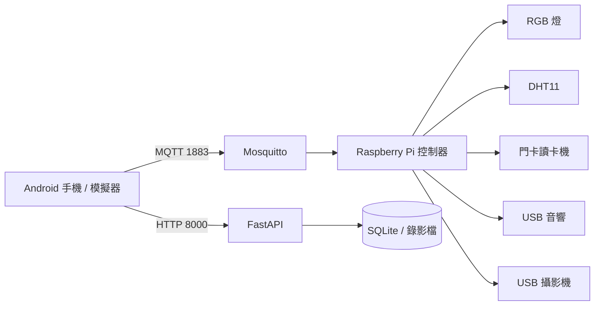

# HouseControl Pi

HouseControl Pi 是一套以 Raspberry Pi 為家庭控制中心的智慧家庭專案。使用者可透過 Flutter Android App 控制燈光、播放音樂、查看攝影機與溫溼度紀錄、管理門卡，以及設定排程與情境模式。

## 系統組成



- `lib/`：Flutter 手機 App。
- `pi/`：Raspberry Pi 控制器、API 與攝影機服務。
- MQTT：傳送即時控制與設備狀態。
- FastAPI：提供攝影機、紀錄、排程、情境與門卡資料。
- SQLite：保存感測紀錄、門卡、排程與情境資料。

## 主要功能

- RGB 燈光開關、色溫與亮度控制。
- YouTube 音樂播放、暫停、停止與音量控制。
- USB 攝影機即時畫面及近期錄影回放。
- DHT11 溫溼度紀錄。
- 家庭成員與門卡綁定、通行紀錄。
- 自動排程與一鍵情境模式。
- 從 YouTube App 分享影片到 HouseControl 播放。

## 快速開始

### 1. 架設 Raspberry Pi

建議使用 Raspberry Pi OS 64-bit、Python 3.11 以上，並先接妥需要的燈光、感測器、讀卡機、攝影機與音響。

```bash
cd ~/housecontrol_pi/pi
sudo apt update
sudo apt install -y mosquitto mosquitto-clients ffmpeg mpv alsa-utils curl
curl -LsSf https://astral.sh/uv/install.sh | sh
uv sync
cp house_control.env.example house_control.env
chmod +x start.sh
./start.sh
```

查詢樹莓派的區域網路位址：

```bash
hostname -I
```

確認服務狀態：

```bash
./start.sh status
curl http://127.0.0.1:8000/health
```

完整安裝、Mosquitto 設定、GPIO 校正、自動啟動與故障排查請見 [Raspberry Pi 架設指南](docs/raspberry-pi.md)。

### 2. 使用 Android 模擬器測試

開發電腦需安裝 Flutter、Android Studio、Java 17 與 Android SDK 37。

```powershell
flutter doctor
flutter pub get
flutter devices
flutter run -d emulator-5554
```

第一次開啟 App 時：

1. 「家庭連線位址」輸入 Raspberry Pi 的區域網路 IP，例如 `192.168.1.50`。
2. 「連線通道」保留 `1883`。
3. 若 Mosquitto 使用匿名連線，家庭帳號與密碼保持空白。
4. 按下「完成設定」。

模擬器與 Raspberry Pi 必須能連到同一個區域網路。更完整的模擬器操作請見 [手機與模擬器指南](docs/mobile.md)。

### 3. 安裝到實體 Android 手機

先在手機開啟「開發人員選項」與「USB 偵錯」，以 USB 連接電腦：

```powershell
flutter devices
flutter run -d <手機裝置 ID>
```

建立可安裝的 Release APK：

```powershell
flutter build apk --release
adb install -r build/app/outputs/flutter-apk/app-release.apk
```

也可以將 `app-release.apk` 傳到手機後直接開啟安裝。手機與 Raspberry Pi 必須連接同一個 Wi-Fi，並允許安裝此來源的應用程式。

> 目前 Android release 使用開發用簽章，適合專題展示與內部安裝。若要上架 Google Play，仍需更換正式 application ID、建立自己的 keystore，並設定正式 release signing。

完整步驟請見 [手機與模擬器指南](docs/mobile.md)。

## 使用方式

1. 先確認 Raspberry Pi 的 `camera`、`controller`、`api` 都在執行。
2. 手機連上與 Raspberry Pi 相同的 Wi-Fi。
3. 開啟 App，完成家庭連線設定。
4. 從首頁控制燈光、查看攝影機與播放音樂。
5. 「家庭」頁可新增成員及綁定門卡。
6. 「自動化」頁可建立排程與情境模式。

網路需允許以下連線：

| 連接埠 | 用途 |
| --- | --- |
| `1883` | MQTT 即時控制 |
| `8000` | FastAPI、攝影機與資料查詢 |

## 專案結構

```text
housecontrol_pi/
├── lib/                       # Flutter App 與服務
├── android/                   # Android 建置與權限設定
├── pi/
│   ├── house_control/         # Raspberry Pi Python 服務
│   ├── tests/                 # 硬體手動測試
│   ├── start.sh               # 統一啟動入口
│   └── house_control.env.example
├── docs/                      # 架構、安裝、部署與簡報文件
├── pubspec.yaml
└── README.md
```

## 文件索引

- [文件中心](docs/README.md)
- [系統與專案架構](docs/system-architecture.md)
- [Raspberry Pi 架設指南](docs/raspberry-pi.md)
- [手機、模擬器與 APK 部署指南](docs/mobile.md)
- [專案簡報](docs/HouseControl-Pi.pptx)

## 常用指令

```bash
# Raspberry Pi
cd pi
./start.sh
./start.sh status
./start.sh logs
./start.sh stop
./start.sh led-test
```

```powershell
# Flutter
flutter pub get
flutter analyze
flutter run -d emulator-5554
flutter build apk --release
```
