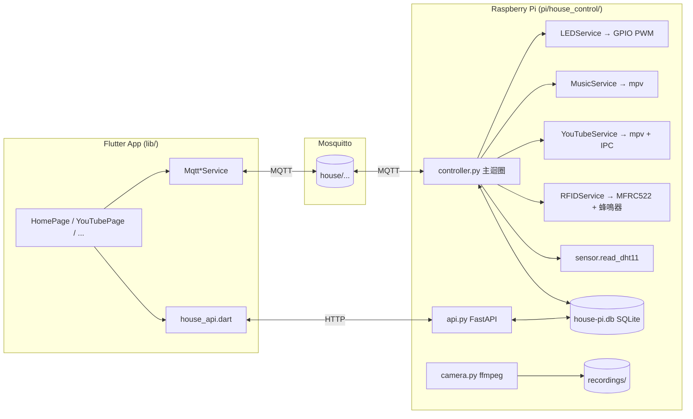

# HouseControl Pi 架構說明

本專案由兩個部分組成：

1. **Flutter 手機 App**（`lib/`）— 使用者介面與 MQTT 用戶端。
2. **樹莓派控制器**（`pi/`）— 連接 GPIO、感測器、攝影機與喇叭的服務集合，透過 MQTT 與 HTTP 和手機 App 溝通。

即時控制與狀態主要使用 MQTT；攝影機、歷史資料、家庭成員、排程與情境管理則使用 FastAPI。手機 App 不會直接執行 Raspberry Pi 的 shell 指令。

---

## 1. Flutter App 端（`lib/`）

### 1.1 檔案結構

| 檔案 | 職責 |
| --- | --- |
| `main.dart` | App 進入點、主題、家庭連線設定、底部導航 `MainShell` 與首頁控制介面。 |
| `mqtt_settings.dart` | `MqttSettings` 資料類別、`MqttSettingsStore` 使用 `flutter_secure_storage` 保存連線設定、共用的 `connectMqttClient()`。 |
| `mqtt_light_service.dart` | 訂閱/發佈 RGB 燈光（`house/room/light/*`），支援 on/off、模式（warm/cool/natural）與亮度。 |
| `mqtt_music_service.dart` | 透過 `house/music/*` 讓 Pi 以 yt-dlp + mpv 播單一 YouTube URL。 |
| `mqtt_youtube_service.dart` | YouTube 播放控制器（`house/youtube/*`），支援暫停、音量調整與標題回報。 |
| `youtube_page.dart` | 家庭音樂 UI：貼連結、播放／暫停／停止、音量控制與操作說明。 |
| `mqtt_rfid_service.dart` | RFID 綁卡、刷卡事件（`house/rfid/*`）。 |
| `mqtt_scene_service.dart` | 情境模式（`house/scene/execute`、`house/scene/result`）。 |
| `house_api.dart` | 樹莓派 FastAPI 的 REST client（歷史資料、情境 CRUD、自動化排程）。 |
| `history_page.dart` | 溫溼度歷史紀錄的瀏覽頁。 |
| `family_members.dart` | 家庭成員與 RFID 卡綁定 UI。 |
| `rfid_card_api.dart` | 門卡與通行紀錄 REST API 的 DTO。 |

### 1.2 Service ↔ MQTT topic 對應

| Dart Service | 發佈 (publish) | 訂閱 (subscribe) |
| --- | --- | --- |
| `MqttLightService` | `house/room/light/set` | `house/room/light/state` |
| `MqttMusicService` | `house/music/play`、`house/music/stop` | `house/music/state` |
| `MqttYouTubeService` | `house/youtube/play`、`house/youtube/stop`、`house/youtube/pause`、`house/youtube/volume` | `house/youtube/status` |
| `MqttRfidService` | `house/rfid/bind` | `house/rfid/event` |
| `MqttSceneService` | `house/scene/execute` | `house/scene/result` |

每個 service 寫法一致：維護 `MqttServerClient`、暴露 `ValueNotifier<ConnectionStatus>` 與 `ValueNotifier<State>`，UI 直接 `ValueListenableBuilder`。新服務照這個 pattern 繼續擴充。

---

## 2. 樹莓派端（`pi/`）

### 2.1 目錄結構

```
pi/
├── house_control/           # Raspberry Pi Python 服務套件
│   ├── __init__.py
│   ├── controller.py        # 主程式；MQTT 迴圈、排程、場景派遣、SQLite schema
│   ├── light.py             # LEDService（GPIO PWM；house/room/light/*）
│   ├── music.py             # MusicService（yt-dlp + mpv；house/music/*）
│   ├── youtube_player.py    # YouTubeService（house/youtube/*，含音量 IPC）
│   ├── rfid.py              # RFIDService（MFRC522；house/rfid/*、蜂鳴器）
│   ├── sensor.py            # DHT11 讀取
│   ├── camera.py            # ffmpeg 分段錄影 + 即時 JPG 更新
│   ├── config.py            # 攝影機／儲存路徑／音訊裝置環境變數
│   └── api.py               # FastAPI，提供歷史資料與情境排程 REST
├── pyproject.toml           # 依賴：paho-mqtt、fastapi、uvicorn、yt-dlp、mfrc522、rpi-gpio
├── start.sh                 # 啟動 camera / controller / api 三支背景行程 + PID 管理
└── house_control.env.example # 環境變數（LED 排線、USB 喇叭 PipeWire sink 等）
```

### 2.2 行程切分

`start.sh` 會同時拉起三個獨立 Python 行程，PID 寫到 `pi/run/`：

* `house_control.camera` — ffmpeg 循環分段錄影，同時刷新 `recordings/live.jpg`。
* `house_control.controller` — MQTT 主控制迴圈，持有 GPIO、RFID、LED、音樂、YouTube 服務實例，並定時 (`run_due_automations`) 檢查自動化排程、每 30 分鐘讀 DHT11。
* `house_control.api` — FastAPI (`uvicorn`)，提供手機查歷史、管理家庭成員、建立情境與自動化排程。

API 與 Controller 都讀寫同一個 `house-pi.db` SQLite（`PRAGMA journal_mode=WAL`），由 controller 寫入即時資料，API 讀取或 CRUD 設定。

### 2.3 MQTT topic 清單

| Topic | 方向 | Payload 範例 | 說明 |
| --- | --- | --- | --- |
| `house/room/light/set` | App → Pi | `{"on":true,"mode":"warm_white","brightness":60}` | 更新燈光狀態。 |
| `house/room/light/state` | Pi → App（retained） | 同上 | 現況回報。 |
| `house/music/play` | App → Pi | `{"url":"https://youtu.be/..."}` | 單首 YouTube 音訊播放。 |
| `house/music/stop` | App → Pi | `{}` | 停止。 |
| `house/music/state` | Pi → App（retained） | `{"state":"playing","url":"..."}` | 播放狀態。 |
| `house/youtube/play` | App → Pi | `{"url":"https://youtu.be/..."}` | 播放 YouTube 音訊。 |
| `house/youtube/stop` | App → Pi | `{}` | 停止。 |
| `house/youtube/pause` | App → Pi | `{}` | 暫停或繼續播放。 |
| `house/youtube/volume` | App → Pi | `{"volume":70}` | 透過 mpv IPC 即時調整音量。 |
| `house/youtube/status` | Pi → App（retained） | `{"state":"playing","url":"...","title":"...","volume":70}` | 含影片標題。 |
| `house/rfid/bind` | App → Pi | `{"member_id":"A01","member_name":"媽媽"}` | 進入 60 秒綁卡等待。 |
| `house/rfid/event` | Pi → App | `{"type":"access_granted", ...}` | 刷卡事件 (`bind_waiting`、`bound`、`access_granted`、`access_denied`、`bind_expired`、`error`)。 |
| `house/rfid/status` | Pi → App（retained） | `{"online":true,"at":"..."}` | 控制器上線訊息。 |
| `house/scene/execute` | App → Pi | `{"scene_id":1,"request_id":"..."}` | 執行情境（會依序派發 light/music 動作）。 |
| `house/scene/result` | Pi → App | `{"ok":true,"results":[...]}` | 情境執行結果。 |
| `house/dht11/reading` | Pi → App（retained） | `{"temperature":27.0,"humidity":65.0}` | 30 分鐘一次。 |

### 2.4 資料流圖



主要流向：

1. 手機 UI 變更 → Service 透過 MQTT 發 `house/*/set`（或 `play`、`execute`）到 broker。
2. Pi `controller.py` 的 `on_message` 依 topic 派發到對應 service，實際操作 GPIO/子行程。
3. Service 動作完成後回 `house/*/state`（retained），讓重新連線的 App 立即恢復 UI。
4. 感測器與刷卡事件由 controller 主動 publish；歷史讀取則透過 FastAPI。

---

## 3. 擴充時的慣例

* 新裝置：在 `pi/house_control/` 新增一個 service class，需要時加 `controller.py` 的 `subscribe` 與 `on_message` 分派；App 端對應一支 `mqtt_*_service.dart`。
* Topic 命名：一律 `house/<裝置>/<動作>`；狀態用 retained，指令不 retained。
* 任何需要外部指令的服務（mpv、ffmpeg、yt-dlp）要在 `pyproject.toml` 或系統套件說明中註記，start script 不要擅自安裝。
